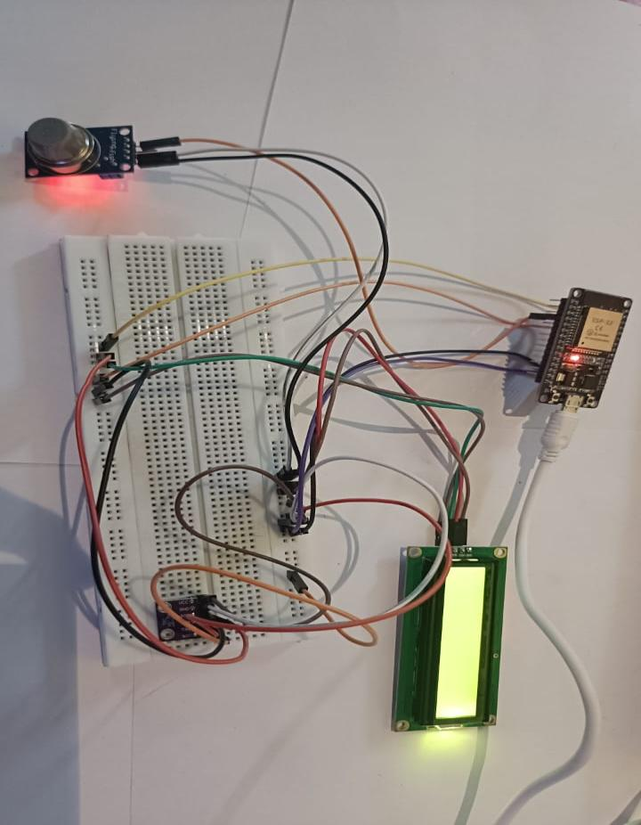
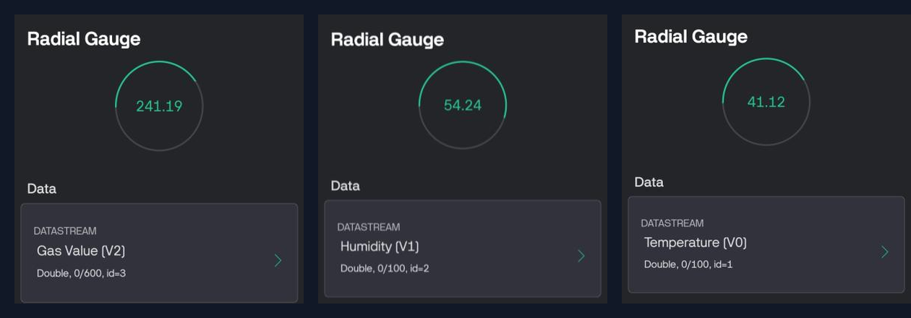
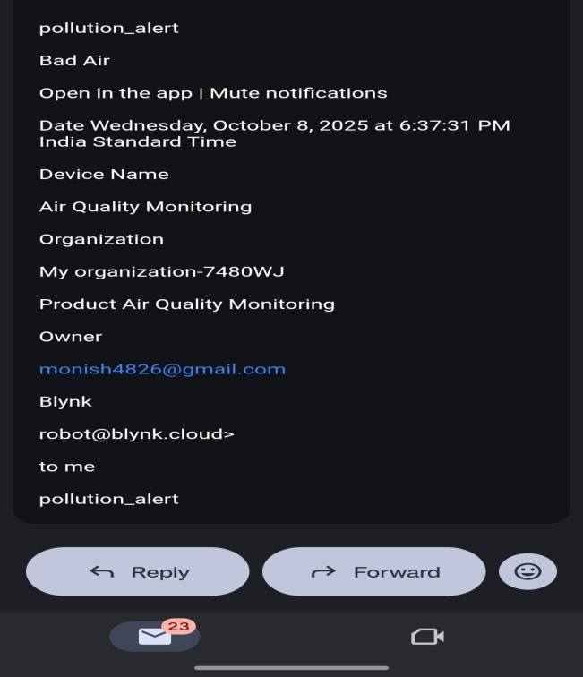
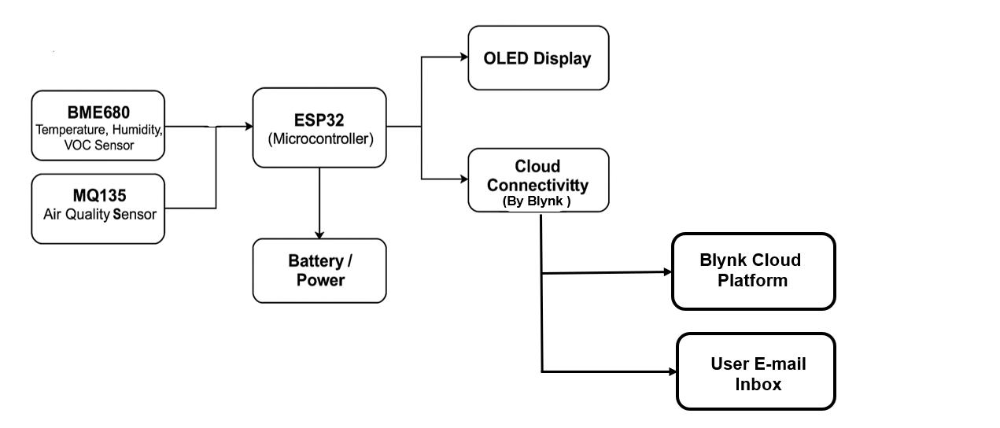

# 🌸 Smart Pollen Allergy Risk & Air Quality Monitoring System

[](https://www.espressif.com/)
[]()
[](https://blynk.io/)
[](LICENSE)

> **Developed by:** Mrityun Jay G & Monish S  

An IoT-based proactive environmental monitoring system designed to protect individuals with respiratory sensitivities and asthma. Built on the **ESP32** microcontroller, the system fuses ambient climate telemetry (temperature & relative humidity) with air pollution metrics (**MQ-135** gas sensor) to detect dangerous atmospheric conditions in real time. 

Unlike passive monitors that simply log data, this system features a **proactive alert engine** that automatically triggers instant **email warnings and mobile push notifications** via the **Blynk IoT platform** when harmful gas levels breach safety thresholds.

---

## 📸 Hardware Prototype & Verification Proofs

<div align="center">
  <table border="0">
    <tr>
      <td align="center" width="50%">
        
        <br />
        <b>Figure 1: Physical Circuit Assembly (ESP32, LCD 16x2, MQ-135, DHT11)</b>
      </td>
      <td align="center" width="50%">
        
        <br />
        <b>Figure 2: Real-Time Blynk Dashboard Telemetry (V0, V1, V2)</b>
      </td>
    </tr>
    <tr>
      <td align="center" colspan="2">
        
        <br />
        <b>Figure 3: Instant Automated Email Alert ("pollution_alert - Bad Air")</b>
      </td>
    </tr>
  </table>
</div>

---

## 📌 Key Innovations & Features

- **Proactive vs. Passive Alerting:** Moves beyond static gauges by dispatching instant automated email warnings (`robot@blynk.cloud`) and mobile notifications when air quality degrades.
- **Dual Visual Interface:**
  - **Local Display:** 16x2 I2C LCD screen cycling between thermal metrics and real-time status (*"Fresh Air"* vs. *"Bad Air"*).
  - **Cloud Monitoring:** Live cloud streaming with radial gauges on the Blynk mobile application.
- **Respiratory Health Focus:** Specifically targeted for asthma sufferers and individuals sensitive to pollen and airborne particulate matter in study rooms and smart homes.
- **Low-Cost & Portable:** Replaces expensive industrial-grade monitoring stations with an accessible ESP32 architecture powered by standard USB / Li-Po batteries.

---

## 🏗️ System Architecture

<div align="center">
  
  <br />
  <b>Figure 4: Hardware and Cloud Interconnect Architecture</b>
</div>

<br />

```mermaid
graph TD
    subgraph Sensing Layer
      S1[MQ-135 Gas Sensor]
      S2[DHT11 Climate Sensor]
    end

    subgraph Processing Unit
      ESP[ESP32 Microcontroller]
      PWR[Power Supply / USB / Li-Po] --> ESP
    end

    subgraph Local Interface
      LCD[16x2 I2C LCD Display]
    end

    subgraph Cloud & Alert Layer
      Blynk[Blynk IoT Cloud Server]
      App[Blynk Mobile App Gauges]
      Email[Automated Email Alert Engine]
    end

    S1 -->|Analog Read - GPIO 32| ESP
    S2 -->|Digital Read - GPIO 2| ESP
    ESP -->|I2C SDA:21, SCL:22| LCD
    ESP -->|Wi-Fi 2.4 GHz| Blynk
    Blynk --> App
    Blynk -->|Threshold > 400 PPM| Email
